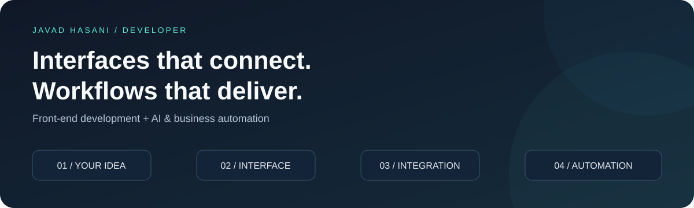

### Front-End Developer · n8n & AI Automation

I build web interfaces and connect the tools behind them—so your team can spend less time on repetitive work.

**Available for freelance projects and remote collaboration**

[Discuss your project](mailto:vadoohasani@gmail.com) · [LinkedIn](https://www.linkedin.com/in/javad-hasani) · [Explore my repositories](https://github.com/javad-hasani?tab=repositories)

---

## What can I build for you?

| Your challenge | What I can build |
| :--- | :--- |
| “We keep moving information between tools manually.” | **n8n workflows** connecting APIs, webhooks, CRMs and databases. |
| “Our website or internal tool needs a better interface.” | **Responsive React & Next.js interfaces** for websites, dashboards and business tools. |
| “We have conversations and data, but no useful summary.” | **AI-assisted workflows** for transcription, structured analysis and reporting. |
| “Our team needs updates without checking every system.” | **Bot notifications and scheduled reports** connected to your existing processes. |

## Featured work / Call intelligence & workflow automation

**An ongoing business project for sales and support teams.**

Working on a system that connects telephony, AI processing, a PostgreSQL database, CRM context and a messaging bot. It turns call information into searchable transcripts, per-call insights and reports for the people who need them.

| Area | My work |
| :--- | :--- |
| **Workflow orchestration** | n8n workflows for call ingestion, processing queues and reporting. |
| **AI integration** | Transcription and structured analysis, with validation of model output. |
| **CRM & APIs** | Read-only customer context integration, phone normalization and error handling. |
| **Reporting & bots** | Role-based access to saved analyses, operator reports and feedback. |
| **Reliability** | Duplicate-processing guards, stored-result reuse, failure tracking and isolated tests. |
| **Knowledge workflows** | Reviewed knowledge content and workflows for identifying learning gaps. |

**Built with:** n8n · JavaScript · PostgreSQL · REST APIs · Webhooks · AI APIs · Docker · GitHub

*The implementation is private. This is a high-level overview; ongoing features are not presented as completed releases.*

## Tools I work with

**Automation & integrations**

**Front-end**

**Data & delivery**

Also in my toolkit

Bootstrap · jQuery · Photoshop · SQL · GitHub Actions

## How I approach a project

**01 — Understand the work**  
Map the current process, the tools involved and what a useful result looks like.

**02 — Build a focused solution**  
Start with a clear scope and a working flow you can review.

**03 — Test the real edge cases**  
Check permissions, missing data, failures and duplicate events.

**04 — Make it maintainable**  
Document the setup, decisions and limitations so the work can keep evolving.

---

### برای کسب‌وکارت چه کاری می‌توانم انجام بدهم؟

من جواد حسنی هستم؛ توسعه‌دهنده فرانت‌اند و اتوماسیون از شیراز. برای طراحی رابط کاربری با React و Next.js، ساخت اتوماسیون با n8n، اتصال CRM و APIها، و پیاده‌سازی گزارش‌ها و فرایندهای مبتنی بر هوش مصنوعی آماده همکاری پروژه‌ای هستم.

**یک فرایند تکراری در کسب‌وکارت داری؟** توضیح بده الان چطور انجامش می‌دهی، از چه ابزارهایی استفاده می‌کنی و چه خروجی می‌خواهی.

[گفت‌وگو درباره پروژه](mailto:vadoohasani@gmail.com) · [ارتباط در لینکدین](https://www.linkedin.com/in/javad-hasani)

---

### Have a workflow to simplify or an interface to build?

Send me **your goal, the tools you use and your timeline**.

**[Let's talk →](mailto:vadoohasani@gmail.com)**

Shiraz, Iran · Open to remote projects

